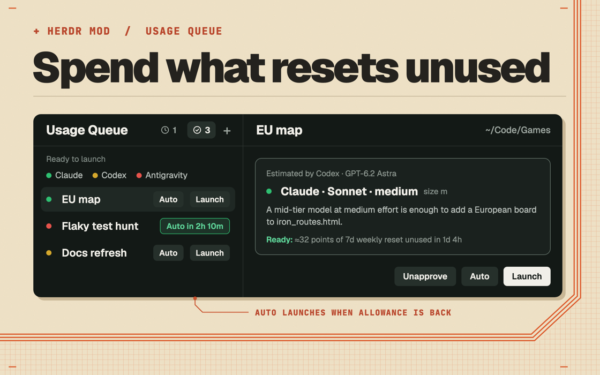

# Herdr Usage Queue

**Queue coding-agent jobs in the [Herdr desktop app](https://herdr.dev) and run them on whichever subscription has allowance to spare.**

Claude Code · Codex · Antigravity

[](LICENSE)
[](https://herdr.dev/gallery/?type=mods)
[](https://bun.sh)



Subscriptions reset their allowance on a clock, and whatever is left when a window resets is
gone. Usage Queue holds jobs you'd like done and launches them on demand or automatically when
there's allowance. You can set each job's size, model and effort by hand or request an estimate. It reads
allowance from [Usage Monitor](https://github.com/EMRahman/herdr-usage-monitor), which must be
installed.

See [DESIGN.md](DESIGN.md) for the design and what's still to come.

## The flow

1. **Add a job** with **+**, or write a JSON file into `~/.config/herdr-app/usage-queue/jobs/`.
   The job appears in **Launch queue** with a **Needs allocation** marker.
2. **Set the size** in the job dialog. Choose **Small**, **Medium** or **Large**, and check the
   agent, model and effort. **Estimate with a model** can suggest those settings using
   subscription allowance. **Save allocation** keeps your choices for later. Size records the
   expected work and the allowance light determines when a job can start.
3. **Launch** from the dialog or the queue. Choose **Auto** to launch as soon as there's allowance (with
   allowance now, Auto is the same as Launch). The queue fetches the repo and makes a new worktree
   on a `queue/<job>-<time>` branch from the remote's latest default branch (`origin/main`), then
   starts the agent there in a background space with the prompt as its first message.

   If allowance reaches its reserve or the reading goes stale, the queue interrupts a working
   agent and resumes it when allowance returns. The row shows the brake status. **Pause auto**
   also pauses resumes. **Let it finish** in the launched job dialog overrides the brake for
   that run.

4. **PR and reviews** (optional, set per job under "When it's done"): **Open a PR** has the agent
   open a pull request when it's done. The queue then checks it on GitHub every 30 seconds and
   sends new review comments back to the agent, up to 3 rounds, each ending in
   `@codex review`. **PR + merge on 👍** also merges it once it gets a 👍 (a 👍 reaction, an
   approving review, or Codex's "Didn't find any major issues"). New comments after the third
   round, or a failed merge, are handed to you with a notification.

   Once the PR is merged (by the queue or by you), the queue tidies up: it closes the job's
   space, removes its worktree, deletes the `queue/…` branch, and deletes the branch on GitHub
   if GitHub didn't. It only does this when everything there is already in the merged PR. A
   worktree with uncommitted or untracked files, ignored files that aren't just build output or
   caches (a `.env`, say), or a branch with commits pushed after the PR, is kept, and you get a notification saying why. It waits while the agent is still working or
   while you have the job's space on screen.

5. **Wait for another job** (optional, under "Wait for" when you add the job or open its dialog).
   The job won't
   launch, by Launch or Auto, until that job is finished: its PR merged, or, without a PR, its
   agent done. Launches fetch the remote's latest first, so the work goes on top of what was
   just merged. With Auto on, it launches by itself once both the job it waits for is finished
   and there's allowance. The sidebar groups blocked jobs under **Waiting for another job**,
   with "… · after <job>" on each row. A PR the queue stopped working on
   (it needs you, or nothing happened for a day) is still checked every 10 minutes for two
   weeks, so merging it yourself starts the jobs waiting on it. To let them go without a merge,
   click **Mark finished** in the launched job's dialog, or **Mark <job> finished** in the
   waiting job's.

Editing a job file resets its allocation and Auto setting. Its queue row shows **Needs allocation**.

## The lights

One per coding agent at the top of the queue, and one beside each job:

| Light | Meaning | Launch |
|---|---|---|
| 🟢 Ready | Allowance would reset unused if not spent | Yes |
| 🟡 Open | Above the reserve, but nothing is going to waste | Yes, it spends allowance you might want later |
| 🔴 Not yet | At or below the reserve (5h: 25%, weekly: 15%) | No |

Hover a light for the numbers.

## Install

```sh
bun herdr-app/install.ts            # into the layout on screen
bun herdr-app/install.ts --layout my-layout
```

It copies `herdr-app/mods/usage-queue/` into `~/.config/herdr-app/mods/` and adds a 230px block
to the sidebar of a personal layout (after Saved Prompts, or after the spaces and agents lists).
To remove it, delete the `usage-queue` block from the layout file and the mod folder.

## A job file

```json
{
  "about": "Find and fix flaky tests in myapp",
  "prompt": "Run the test suite 5 times, list tests that flip, and fix the top one.",
  "where": { "worktree": { "repo": "~/Code/myapp" } },
  "agents": ["claude", "codex"],
  "model": { "claude": "sonnet" },
  "effort": { "claude": "medium" },
  "priority": 2,
  "permissions": "edit",
  "launch": "approve"
}
```

`model` and `effort` are optional. Set both to prefill the allocation for an agent.
`"launch": "auto"` enables Auto when you click **Save allocation**.
`"permissions"` selects **Agent default** (`"default"` or omitted), **Plan** (`"plan"`), or
**Edit** (`"edit"`). You can also pick a profile when adding a job in Herdr. The selected agent
uses its own permission flags for Plan and Edit. See [permission profiles](DESIGN.md#permission-profiles)
for the mappings.
`"after"` is the id (file name) of a job to wait for. `"pr"` is `"off"` (default), `"review"` (open a PR and address reviews) or `"merge"` (and merge
it on a 👍); it needs the GitHub CLI (`gh`) signed in.

`"base"` is the commit the job starts from, taken at launch: `"remote"` (default: fetch, then the
remote's default branch, i.e. the repo's latest on GitHub), `"local"` (your checkout's HEAD,
unpushed work included), or a branch name (that branch on the remote, fetched). Without a remote,
or when the fetch fails, it starts from your local HEAD and the launch notification says so.

## Agents and models

Defaults are in `herdr-app/mods/usage-queue/catalog.js`. To change them, write
`~/.config/herdr-app/usage-queue/catalog.json`; each entry replaces the default agent's fields by id:

```json
{ "agents": [{ "id": "codex", "models": [{ "id": "gpt-6.2-astra", "label": "GPT-6.2 Astra", "tier": "big" }] }] }
```

Only `big` models run estimates. Antigravity models find their allowance group by their label.
For a custom agent, set its `permissions` field to argv arrays for the profiles it supports.

## Files

| Path | What |
|---|---|
| `~/.config/herdr-app/usage-queue/jobs/*.json` | Job definitions |
| `~/.config/herdr-app/usage-queue/state.json` | Estimates, approvals, launches (the mod writes it) |
| `~/.config/herdr-app/usage-queue/history/*.jsonl` | Every event, append-only |

## Develop

```sh
bun test                                       # rule, catalog, estimates, queue, git base
herdr-app check herdr-app/mods/usage-queue     # loads the mod once
bun herdr-app/preview/render.ts                # redraws herdr-app/preview.png (needs Chrome)
```
