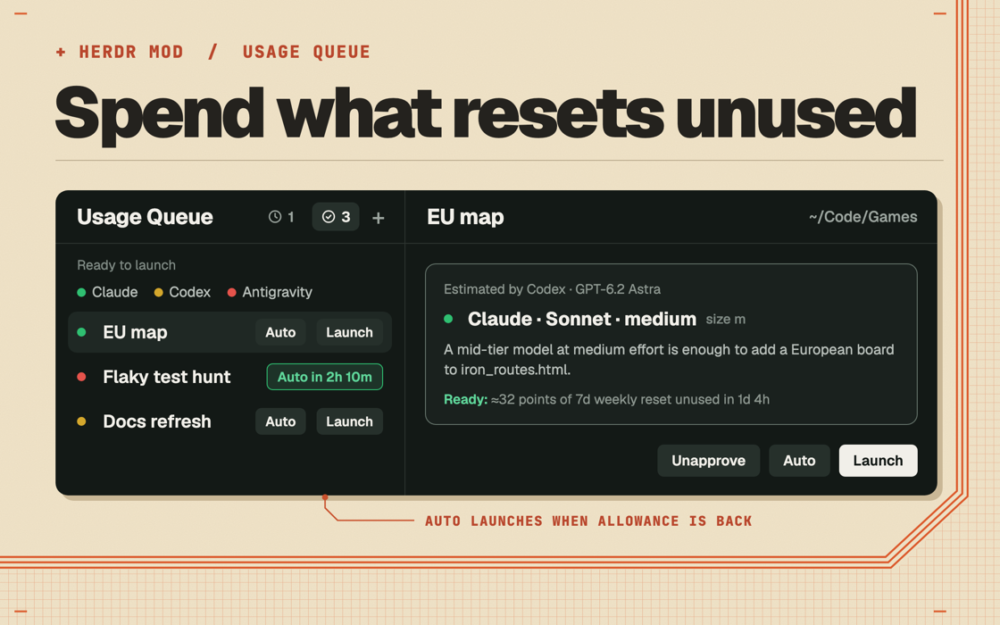

# Usage Queue

Queue coding-agent jobs in the sidebar and run them on whichever subscription has allowance to
spare. A big model recommends the model and thinking effort for each job; you approve it, then
click **Launch**, or **Auto** to have it launch by itself once there's allowance. Each job runs
in a new git worktree, branched from the repo's latest commit on its remote, in a background
space. Allowance comes from [Usage Monitor](https://github.com/EMRahman/herdr-usage-monitor).

## What you see

- **A sidebar block** below the Spaces / Agents (/ Context) lists, above Saved Prompts when
  there is one. It's a weighted share of the sidebar (`weight: 0.35`, `min: 90`), so it resizes
  like the lists. `chrome` background, 1px `border` line above.
- **Header**, 34px, 16px left padding, 8px right: `Usage Queue` at 11.5px medium in `dim`,
  filling the row; then two view icons and `+`:
  - **Pending Launch Approval**: `mods/workspace-chrome/clock.svg`, 14px, and its count.
  - **Ready to Launch**: `mods/workspace-chrome/circle-check.svg`, 14px, and its count.

  Each is 26px tall, 8px side padding, 6px gap, radius 6, count at 11.5px medium; the chosen
  one on `selected` with `foreground`, the other `muted` (a zero count in `dim`). The tooltip
  names the view. `+` is a 24px square, radius 6, `plus.svg` at 14px in `dim` (`hover` behind
  it): **Add a job**, or "continue your draft" when one is saved.
- **Below the header**, 16px side padding, 11px `dim`: "Pending launch approval" or "Ready to
  launch". In Ready to Launch, when any job is on Auto, a "Pause auto" switch at the right
  (`dim`, `foreground` on hover); while paused, "Paused · resume" in the yellow light colour.
- **Lights**, 16px side padding, 12px apart: one per coding agent that has a reading (Claude,
  Codex, Antigravity): an 8px dot and its name at 11.5px in `muted`. Hover: the agent's verdict
  and each of its pools' reasons. Fixed colours, as Usage Monitor's: green `#2fbf71`, yellow
  `#d4a72c`, red `#e5534b`. With no readings, one line instead: "Reading allowance…" or the
  error.
- **Rows**, 8px side padding, scrolling: 28px tall, radius 7, 8px gaps, `hover` behind them. A
  7px dot (the job's route's light, else the best of its agents'), the job's title at 12.5px in
  `foreground` (cut with `…`), and on the right:
  - **Pending**: "Estimate", "Review" (an estimate or a pinned model is in), "Failed" in red, or
    a spinner (`.frames`) while estimating; 11.5px.
  - **Ready**: two buttons, 22px tall, 7px side padding, radius 5, 11.5px medium on `raised`:
    **Auto** and **Launch**. Launch is `dim` and does nothing on red. A job on Auto shows one
    highlighted button instead, `accent` text and border on `selected`: "Auto in 2h 10m" (the
    time to the next reset), "Auto now", or "Paused".
  - Job files that can't be read show as `dim` rows with a red dot and the error.
  - Under Ready, a "Launched" heading (11px medium `dim`) and the last five launched jobs in
    `muted` with how long ago.
- **Narrow sidebar** (under 160px): only the two view icons, stacked.
- **The job dialog** (580px, `popover`), opened by clicking a row: the title (15px semibold),
  repo · agents · priority · file, where it starts from ("the remote's latest default branch
  (fetched), taken when it launches"), and the prompt in a scrolling box. Then:
  - **1 · Estimate**: the big models that can run an estimate, each a 30px row with its light,
    name and reason, the suggested one marked "Suggested" in green; red ones at half opacity
    and not clickable. "Estimate with …" runs it; while it runs, a spinner and the seconds.
    **Show prompt** shows what it sends; after a run, **Show reply** (the raw reply and the
    CLI's errors) and **Open log**. A failure shows in red.
  - **2 · Proposal**: one card per agent from the estimate (light, agent · model · effort,
    size, "recommended", the reason, and its allowance), and Model and Effort chips (24px,
    radius 6) for the chosen one.
  - Footer: **Delete job** (red text), then **Approve**; for an approved job, **Unapprove**,
    **Auto** (or **Cancel Auto**) and **Launch**.
- **The add dialog** (560px): Title, Prompt (150px), Repository (the focused pane's folder, or
  **Choose…**), agent chips (not-installed ones marked), Priority chips (1 high, 2 normal,
  3 low), **Clear** when anything is typed, **Close** and **Add to queue** (⌘↵).

## How it behaves

- **Readings**: every 60s the sidebar copy runs Usage Monitor's `bridge.js --cached` (Bun) and
  judges each pool (a provider account, or an Antigravity model group):
  - **Red (Not yet)**: any window at or below its reserve (5h: 25%, weekly: 15%, daily: 15%,
    monthly: 10%), less than 5 points above it, or a reading older than twice the provider's
    refresh interval plus 5 minutes.
  - **Green (Ready)**: the smallest "spare" across windows that run on a clock (% left minus
    % of time left) is 20 or more, or the binding reset is under an hour away and 5 or more
    would be lost.
  - **Yellow (Open)**: anything else above the reserve.

  While any job is on Auto it runs the bridge without `--cached`, so readings stay fresh even
  when Usage Monitor's readout isn't polling; the bridge still asks providers only on its own
  schedule (3 / 15 / 60 min by activity, and just after a reset).
- **Jobs** are `~/.config/herdr-app/usage-queue/jobs/*.json`; a folder watch picks up new and
  edited ones at once. Approval stores a hash of the file: editing it sends the job back to
  Pending Launch Approval.
- **Estimate**: one-shot, read-only, in the job's repo, with the chosen big model at high
  effort: `claude -p --permission-mode plan --output-format json`, `codex exec --sandbox
  read-only --ephemeral`, or `agy --mode plan --output-format json --print=<prompt>`. The
  prompt carries the job, the repo's file list (`git ls-files`, first 150) and the top 40
  lines of its README, the agents' models and efforts, and the lights, and asks for one JSON
  object. Unknown agents, models and efforts in the answer are dropped. Each run is logged to
  `usage-queue/estimates/<job>-<time>.txt`. The proposal is the estimate's route with the
  greenest, most urgent pool; ties go to the estimator's recommendation.
- **Launch**: `git fetch` the remote, then `git worktree add -b queue/<job>-<time>` under
  Herdr's `worktrees.directory` (default `~/.herdr/worktrees`) at `<remote>/<default branch>`
  (a job's `"base"` can say `"local"` or a branch). No remote, or a failed fetch: the local
  HEAD, with a warning. Then `space.new {folder, argv, task: <prompt>, focus: false}`: the
  agent starts with the prompt as its first message and shows in Spaces, Agents and Context
  like any other. A notification says where it started (`origin/main @ 1a2b3c4`).
- **Auto**: with allowance now (light not red), the same as Launch. Otherwise the job waits;
  each minute the queue launches Auto jobs whose light has left red, by priority, at most one
  per pool, and none on a pool something launched on in the last 10 minutes. Never on red.
- **PR and reviews** (`"pr"`, or "When it's done" in the dialogs: No PR / Open a PR / PR +
  merge on 👍): the launch adds instructions to the prompt (commit, push the branch, `gh pr
  create`, don't merge). The sidebar copy then checks every 30s which agent is in the worktree
  and, every 2 minutes, GitHub through `gh`: first `gh pr list --head <branch>`, then the PR's
  reactions, comments, reviews and inline comments. A 👍 (reaction, approving review, or
  "Didn't find any major issues") newer than the last round merges it (squash, else merge, else
  rebase) or, in review mode, notifies you. Otherwise new feedback (inline comments, change
  requests, others' comments; not yours, not Codex's summary) goes to the agent with
  `hc send --if idle` as "Review round N of 3", ending in "@codex review"; a new agent is started
  in the worktree if the old one is gone. New feedback after round 3, a failed merge, or a day
  with nothing happening ends the watch, with a notification. Launched rows show "PR #12 ·
  round 1/3", "Merged #12", "👍 #12" or "Needs you #12".
- **Wait for** (`"after"`, or "Wait for" in a Ready job's dialog: Nothing, or any unfinished
  job that doesn't itself wait on this one): Launch is disabled ("Waiting") and Auto only
  schedules until that job is finished: its PR merged (a PR approved in review mode stays
  watched until you merge it), or, without a PR, its agent worked and then went idle or away.
  The row adds "· after <job>" in `dim`. A deleted job doesn't hold anything up.
- **Draft**: the add form is kept in memory and in `usage-queue/draft.json` (half a second after
  typing stops, and when it closes), so Esc never loses it.
- **History**: every event (added, estimated, approved, scheduled, launched, …) is appended to
  `usage-queue/history/<day>.jsonl`; current state is `usage-queue/state.json`.

## Built from

- **Layout**: `{"id": "usage-queue", "type": "block", "size": {"weight": 0.35}, "min": 90,
  "content": {"mod": "usage-queue"}}`, inserted right after the `sidebar-lists` column (else
  after `agents`, else before `usage-monitor` or `sidebar-footer`). `herdr-app/install.ts` does
  it in the layout on screen, or `--layout <name>`; Herdr's own layouts are refused.
- **`mods/usage-queue/`**: `mod.json` (`place: "none"`); `main.js` (the view: sidebar, job
  dialog and add dialog by `props().dialog`); `rule.js` (pools and lights from the bridge
  report); `queue.js` (job files, the lists, choices, what Auto launches); `catalog.js`
  (agents, models, efforts, launch and estimate commands; `usage-queue/catalog.json`
  overrides any agent by id); `estimate.js` (the prompt, parsing the answer); `launch.js`
  (running estimates, the worktree and the launch); `base.js` (which commit to start from);
  `store.js` (every file read and write); `time.js`.
- **`herdr` functions**: `theme`, `props`, `shared` / `setShared` (a revision that redraws
  every copy), `openOverlay` / `closeOverlay`, `run` (`space.new`, `space.select`), `exec`,
  `readTextFile`, `writeTextFile`, `watchFolder`, `knownAgents`, `pickFolder`, `notify`,
  `focused`, `panes`, `spaces`, `appHome`, `home`, `checking`; `fs/promises` and `crypto`.
- **Programs it runs**: Bun (Usage Monitor's bridge, which reaches the providers' usage
  endpoints), `git`, the agent CLIs (`claude`, `codex`, `agy`), `gh` (GitHub, for PR jobs:
  reads the PR, merges it), `hc send` (review rounds), and `open` for a log or a PR. It reads
  only its own folder, Herdr's `settings.json`, Usage Monitor's mod folder and the jobs' repos.

## Watch out

- **Data lives outside the mod folder.** Herdr reloads a mod whenever a file in its folder
  changes, so jobs, state and logs are in `~/.config/herdr-app/usage-queue/`.
- **Dialogs lose their work when they close.** Estimates and launches are handed to the sidebar
  copy, which outlives them; a dialog runs them itself only when there's no sidebar copy.
- **A fixed-height block next to another one drags badly**: Herdr resizes the fixed block on a
  line you drag. The queue is weighted and sits outside the lists column so its top line
  moves as dragged.
- **Headless estimators can't ask for permission.** Antigravity answers with nothing when a
  command it tried is denied; that's why the prompt carries the repo's file list and says not
  to run commands. `agy` also needs the prompt attached: `--print=<prompt>`.
- **Setting a text field fires its change handler**: set the other fields before `set_value`.
- Dates are formatted by hand: the runtime ignores `toLocaleString`'s options.
- No brake yet: a launched job isn't stopped if its pool reaches the reserve, and the queue
  doesn't detect when it's done. Agents still stop at permission prompts.
- Needs Usage Monitor installed (its bridge), Bun, git, and at least one of the agent CLIs.

## Done when

- `herdr-app check herdr-app/mods/usage-queue` passes and `bun test` passes.
- The block shows under the lists with a light per signed-in agent; hovering one shows each
  pool's reason.
- **+** adds a job; Esc keeps the draft and **+** brings it back.
- A new file in `usage-queue/jobs/` shows in Pending Launch Approval within a second.
- **Estimate** with a suggested big model fills the proposal; **Show reply** and **Open log**
  show what came back.
- **Approve** moves the job to Ready to Launch; editing its file moves it back.
- **Launch** makes `queue/<job>-<time>` from `origin/<default branch>` and the agent appears in
  a new space, in Agents, and in Context after its first answer.
- **Auto** on a red job shows "Auto in …" and launches by itself after the reset; on a green
  or yellow one it launches at once.
